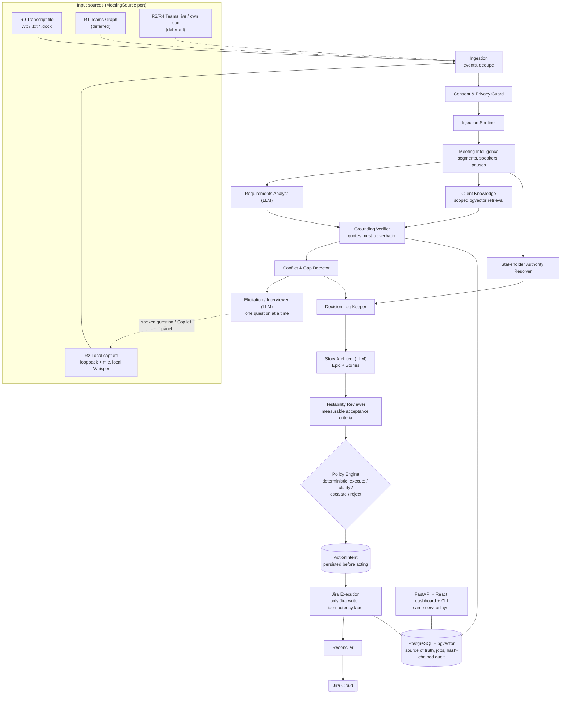

# Agentic BA SDLC Platform

An AI **Technical Business Analyst**. It joins a client meeting (or reads a transcript), interviews non-technical people in plain language, keeps evidence-backed requirements per client, finds gaps and contradictions, and creates a Jira **Epic with linked Stories** safely: with evidence, authority checks, an audit trail and crash recovery.

**Differentiator:** persistent product understanding + evidence-backed requirements + safe autonomous execution, not "AI writes Jira tickets".

**Open source** under the [Apache License 2.0](LICENSE): anyone may use, modify and redistribute it, including commercially. See [COPYRIGHT.md](COPYRIGHT.md) for the copyright and contribution policy.

This README is the complete operator guide. Deeper design docs are in `docs/` (listed at the end). Paths in this guide assume the repository is cloned to `D:\BaAi`; substitute your own folder.

---

## 1. Quick start

**Prerequisites:** Windows 10/11 with PowerShell, [Docker Desktop](https://www.docker.com/products/docker-desktop/) (WSL2), Python with `pip install uv` (uv provisions Python 3.12), Node.js 20+, and, for real analysis, the [Claude Code CLI](https://docs.anthropic.com/en/docs/claude-code) logged in. A Jira Cloud site and API token are only needed for Jira delivery. Live capture is Windows-only (WASAPI); transcript import works without audio.

**First time on a fresh clone:**
```powershell
git clone <this-repo-url> D:\BaAi ; cd D:\BaAi
Copy-Item .env.example .env       # then edit .env: SESSION_SECRET, LLM_PROVIDER=claude_cli, EMBEDDING_PROVIDER=fastembed, Jira values
.\scripts\dev.ps1 up              # Postgres+pgvector on 127.0.0.1:5433 (creates ba and ba_test)
.\scripts\dev.ps1 migrate
cd backend ; python -m uv sync --extra capture ; python -m uv run ba create-user you@example.com ; cd ..
cd frontend ; npm install ; cd ..
```
With `LLM_PROVIDER=fake` and `EMBEDDING_PROVIDER=fake` (the template defaults) everything runs without Claude or model downloads, which is handy for a first look and for tests.

**Every day:**
```powershell
.\scripts\run-all.ps1            # starts: database, migrations, API, worker, dashboard (each in its own window)
```
Then open the dashboard at **http://127.0.0.1:5173** and sign in with the user you created. There are no built-in accounts.

### Create a new dashboard user

```powershell
cd D:\BaAi\backend
python -m uv run ba create-user you@example.com        # asks for a password (minimum 12 characters)
python -m uv run ba list-users                          # shows who can log in
python -m uv run ba set-password you@example.com        # reset a forgotten password (asks twice)
```
There is no self-signup page on purpose: users are created by whoever can run the CLI. Sessions are signed cookies (8 hours), every mutation needs a CSRF token, and 5 wrong passwords lock that account for 5 minutes.

### Which terminal / folder? (read this once)

| Situation | What to type |
|---|---|
| Any terminal, any folder | Use the **full path**: `D:\BaAi\scripts\run-all.ps1 -Autonomous` (the scripts do not depend on the folder, on PATH, or on an activated virtual environment) |
| Terminal opened in `D:\BaAi` | `.\scripts\run-all.ps1` |
| Terminal in `D:\BaAi\backend` | `..\scripts\run-all.ps1` (**not** `.\scripts\...`, that folder does not exist inside `backend`) |
| Prompt starts with `(ba-platform)` (venv activated) | Run CLI commands **without** the prefix: `ba list-users`, `ba create-user ...`. Everything in this guide written as `python -m uv run ba ...` is then just `ba ...` |
| Venv not activated | `python -m uv run ba ...` from `D:\BaAi\backend`, or `D:\BaAi\backend\.venv\Scripts\ba.exe ...` from anywhere |

If PowerShell refuses to run a script: `Set-ExecutionPolicy -Scope Process -ExecutionPolicy RemoteSigned` (affects only that window).

### Start / stop

```powershell
.\scripts\run-all.ps1                 # safe default: Jira actions are RECORDED, nothing is written (AUTONOMY_MODE from .env = dry_run)
.\scripts\run-all.ps1 -Mode propose   # actions wait for your approval in the dashboard
.\scripts\run-all.ps1 -Autonomous     # the worker creates Jira issues with NO approval (only the allowlisted project, SCRUM)
.\scripts\stop-all.ps1                # stops API / worker / dashboard / capture. The database keeps running (your data is safe)
docker compose stop db                # stop the database too
```
Health check: http://127.0.0.1:8000/health returns `{"status":"ok"}`.

---

## 2. What it does

```
 audio / transcript file
        |
  [ capture companion ]  ba capture : WASAPI loopback + mic, local Whisper, optional spoken questions
        |  text segments only (audio is never saved)
  [ API :8000 ] FastAPI  <--->  [ Dashboard :5173 ] React
        |
  PostgreSQL + pgvector  <----  [ worker ] ba worker : durable jobs
        |                         meeting.analyze    -> extract requirements and questions (Claude)
        |                         interview.plan     -> the next spoken question (Claude)
        |                         autopilot.deliver  -> confirm, draft, policy check, Jira
        |                         jira.execute_intent
        v
     Jira Cloud (only one module may talk to it)
```
Long-running processes: **API**, **worker**, **dashboard**, plus `ba capture` only during a live meeting. All state is in PostgreSQL; if any process dies, jobs resume.

### Architecture

A Python modular monolith with replaceable adapters (no Kafka/Redis/Celery). PostgreSQL + pgvector is the single source of truth for knowledge, jobs and the audit trail. The agent pipeline (from `docs/plan.md` §4):



Solid lines are implemented; dotted sources are designed but deferred (no Microsoft 365 tenant). LLM agents only *propose* schema-validated output; the lifecycle guards and the policy engine (plain code) decide. Each agent's responsibility is listed in `docs/plan.md` §4.1, and the engineering contract is in `CLAUDE.md`.

Rules enforced in code and tests (not prompts):
- Every requirement has **evidence**: a verbatim quote, checked against the transcript. Invented quotes are rejected.
- Speaker identity is never guessed. A human declares or verifies who may confirm scope.
- Jira writes only happen through a persisted **ActionIntent** with an idempotency label `ba-intent-...`. A timeout never creates a duplicate.
- The LLM proposes; **code decides** (lifecycle guards, policy engine, when the agent may speak).
- Every failure is visible (logs, API, dashboard, audit chain). Kill switch stops all Jira writes instantly.

---

## 3. The dashboard (what each screen does)

Left sidebar: choose the **client**, create a **New client**, navigate. Top bar: live indicator (auto-refresh every 5 s), mode pill, **kill switch**, refresh, search. **Ctrl+K** opens the quick-jump palette (screens, clients, any requirement, theme, kill switch). Dark/light theme in the sidebar.

| Screen | What you can do |
|---|---|
| **Overview** | Counters (requirements, Jira issues, open questions, needs-attention), requirement pipeline donut + funnel, a "Needs attention" list that links to the problem, recent Jira actions and requirements |
| **Live capture** | **Start and run a call from the browser** (no terminal): pick the client and project from drop-downs, the call title, mode (Interview: the agent speaks / Listen only), autopilot toggle, who the other person is, the consent text, and the audio devices and voice (lists come from this machine). **Test the agent's voice** and **Test: can I hear the call?** buttons, a readiness checklist and the Teams settings to use. While the call runs: ON AIR banner and timer, the live chat, interview coverage and the technical log, and **End call & analyze**. Only one call at a time |
| **Requirements** | Search + filter by status and kind. Click one for the **"Why?" panel**: verbatim evidence (speaker, time, identity linked or not), Jira draft and testability flags, every policy decision with rule IDs, conflicts, version history. Buttons **Confirm / Mark ready / Reject** (a refusal shows its exact reason) and a **Correct** form that saves a new version |
| **Jira actions** | Every action the platform took or planned, with a plain explanation of its status, Jira key links, errors, and **Approve / Reject** when a mode needs you |
| **Meetings** | List with status (live, analyzing, analyzed, failed, degraded) and failure reasons. **Import transcript** (drag a .vtt/.txt/.docx, consent required). Click a meeting: **autopilot report** (what was created, what was held and why), **draft minutes**, and the **live interview** view (topic coverage ring, next planned question) |
| **Conversations** | **WhatsApp-style chat of every call**: calls grouped by date on the left; on the right the full conversation with the client's words on the left and the BA assistant's replies on the right (green), day separators, times, search inside the chat, download as text. Updates live while a call is running. Read-only |
| **Insights** | Conflicts and duplicates (never auto-resolved) and open questions (blocking ones first) |
| **People** | Stakeholders: toggle **decision authority** and **identity verified**. Only verified + authority can confirm requirements |
| **System** | Kill switch, autonomy mode, allowed Jira projects, audit-chain verify, job list (failed ones in red), create a **project** linked to a Jira key |

The header mode pill shows the **API process's** `AUTONOMY_MODE`. The **worker** has its own (set in the window that starts it); `run-all -Autonomous` sets both.

Not in the dashboard (use the CLI): set-password, backups.

---

## 4. Where everything is

| Thing | Where |
|---|---|
| Code | `D:\BaAi\backend\app` (Python), `D:\BaAi\frontend\src` (React) |
| Settings and secrets | `D:\BaAi\.env` (git-ignored). Template: `.env.example` |
| **Database** | Docker container `baai-db-1` (image `pgvector/pgvector:pg16`), volume `ba_pgdata`. **Host `127.0.0.1`, port `5433`, user `ba`, password `ba_dev_password`, database `ba`** (tests use `ba_test`) |
| Migrations | `backend/migrations/versions/0001..0010` (Alembic) |
| Logs | JSON on stderr in each service window. Persistent accountability in tables `audit_events`, `llm_call_logs`, `jobs`, `policy_decisions` |
| Backups | `D:\BaAi\backups\` (from `scripts\backup.ps1`) |
| Speech/embedding models | `%USERPROFILE%\.cache\huggingface` (downloaded once) |
| Docs | `docs/` |
| Quality dataset and baseline | `backend/tests/eval/` |

### Look inside the database
**For a presentation:** `.\scripts\db-viewer.ps1` then `docker compose --profile tools up -d adminer`, open **http://127.0.0.1:8080** and sign in with System `PostgreSQL`, Server `db`, user **`ba_viewer`**, password **`viewer_demo`**, database `ba` (read-only, cannot see password hashes). Ready-made demo queries and a talk track are in `docs/db-presentation.md`.

For normal development, GUI: DBeaver / pgAdmin / VS Code SQL extension with the connection above. Terminal:
```powershell
docker exec -it baai-db-1 psql -U ba -d ba
```
```sql
\dt                                                          -- all tables
select id, name from clients;
select status, count(*) from requirements group by 1;
select title, kind, status from requirements where client_id = '<client_id>' order by created_at;
select quote, speaker_label, attribution_source, confirmation_quote from evidence where requirement_id = '<req_id>';
select kind, status, jira_key, last_error from action_intents order by created_at desc limit 20;
select kind, status, attempts, last_error from jobs order by created_at desc limit 20;      -- failed jobs show here
select event_type, payload, created_at from audit_events order by id desc limit 30;         -- append-only, hash-chained
select agent, exit_class, model, duration_ms, cost_usd from llm_call_logs order by created_at desc limit 20;
select outcome, rule_ids, reason, inputs->>'mode' from policy_decisions order by created_at desc limit 10;  -- why it acted (or not)
```
Table groups: **tenancy** `clients, projects, users` | **meetings** `meetings, consent_records, transcript_segments` (working copy, deleted right after analysis), `conversation_messages` (the kept, readable chat record) | **knowledge** `requirements, requirement_versions, evidence, open_questions, stakeholders, knowledge_chunks (vector), conflict_records` | **delivery** `story_drafts, action_intents, jira_issue_mappings, jira_schema_snapshots, policy_decisions` | **platform** `jobs, audit_events, llm_call_logs, system_flags, purge_runs`.

---

## 5. Workflows (CLI)

CLI = `ba <command>` when the venv is active (prompt shows `(ba-platform)`), otherwise `cd D:\BaAi\backend; python -m uv run ba <command>` (`uv` is a Python module in the system Python, not on PATH and not inside the venv). `ba --help` and `ba jira --help` list everything.

**Set up a client (once)** (or use the dashboard: *New client*, then System > *New project*)
```powershell
ba create-client "Acme School"                              # prints <client_id>
ba create-project <client_id> "Portal" --jira-key SCRUM     # key must be in JIRA_PROJECT_ALLOWLIST; prints <project_id>
ba jira discover <client_id> SCRUM                          # caches issue types and required fields (autopilot also does it automatically)
ba list-clients
```

**A. From a transcript file** (no audio needed; or drag the file in Meetings > Import transcript)
```powershell
ba import-transcript <client_id> notes.vtt "Kickoff" --consent-basis "All participants consented"
ba worker --once                                            # process queued jobs, then exit
ba list-requirements <client_id>
ba minutes <client_id> <meeting_id> --out minutes.md
```
`.vtt`, `.txt` (`Speaker: text`, optional `[mm:ss]`) and `.docx` work. A consent basis is mandatory.

**B. Live meeting, Copilot mode** (the agent only suggests questions to you, privately)
```powershell
ba capture <client_id> "Title" --consent-basis "..." --email you@example.com --password ...
```
`ba capture --list-devices`, `--list-voices`; `--loopback-device`, `--mic-device`; `--duration 1800` caps the length; Ctrl-C ends it. Needs the API running.

**C. Live meeting, Interview mode + autopilot** (the agent speaks; this is what ran in Teams). **Easiest: dashboard > Live capture** (fill the form, press *Start capture*; no command needed). The command below is the same thing for the terminal. Full procedure: `docs/teams-test-procedure.md`.
```powershell
ba capture <client_id> "Kickoff" --consent-basis "..." --interview --autopilot --no-mic `
  --remote-name "Zain" --remote-role "Client sponsor" --remote-authority `
  --project-id <project_id> --agent-output-device "CABLE Input" --agent-voice "Microsoft Zira Desktop"
```
In Teams on this laptop: **Mic = CABLE Output**, **Speaker = Speakers (NVIDIA Broadcast)** (set both explicitly), both unmuted; the person speaking joins from another device with headphones. The agent introduces itself as an AI, asks one plain question at a time, confirms back, closes by itself; the worker then analyzes and (autopilot) creates **one Epic and linked Stories** in the backlog. Held items and the reason are shown in Meetings > the meeting > Autopilot report.

### Follow-up calls (the agent remembers)
Call the same client again (same `client_id` and `--project-id`) and the agent **knows the history**: before each call the platform builds a summary from the database (earlier calls, requirements with their Jira keys, the existing Epic, open questions, topics already covered) and gives it to the interviewer. It opens with *"Hello again! ... Last time we talked about <goal>. I have N requirements noted and M open questions. Shall we pick up where we left off?"*, does not re-ask answered topics, goes to the open questions first, and checks whether anything changed. Autopilot **reuses the existing Epic** (no second Epic) and attaches new stories under it. A brand-new client gets the normal first-call opening. The summary is built in `backend/app/services/context.py` and is always scoped to the client (and project).

### Starting a call from the dashboard (how it works)
The API starts the capture program on this computer (it needs this machine's audio), passes it your current dashboard session instead of a password, streams its log back, and ends it cleanly when you press **End call & analyze** (the meeting is closed and the analysis starts, exactly like Ctrl-C). Audio device and voice lists come from a short helper process (`app/capture/probe.py`) because Windows audio cannot be queried from the API's worker threads. If you restart the API while a call is running, the call keeps going but the dashboard loses its handle: end it from the terminal (Ctrl-C) or with `stop-all.ps1`.

**D. Deliver one requirement to Jira by hand**
```powershell
ba set-stakeholder <client_id> "Priya" --authority --verified --note "checked by me"   # also links their evidence
ba transition <client_id> <req_id> confirmed "owner agreed"       # refused unless every guard passes
ba jira draft   <client_id> <req_id> SCRUM                        # Claude drafts + testability review
ba jira deliver <client_id> <req_id> SCRUM                        # policy -> intent according to AUTONOMY_MODE
ba jira approve <client_id> <intent_id>                           # only when it says awaiting_approval
ba worker --once                                                  # executes approved intents
ba jira intents <client_id>
```

**E. Controls and maintenance**
```powershell
ba kill-switch on|off                         # instantly pause/resume ALL Jira writes (also in the dashboard)
ba verify-audit --client-id <client_id>
ba purge                                      # retention purge now (the worker also runs it hourly)
ba list-users ; ba set-password <email>
.\scripts\backup.ps1 backup ; .\scripts\backup.ps1 drill     # backup + restore drill (verifies audit chains)
```

---

## 6. Configuration (`D:\BaAi\.env`)

| Variable | Meaning (default) |
|---|---|
| `JIRA_BASE_URL`, `JIRA_EMAIL`, `JIRA_API_TOKEN` | Jira Cloud Basic auth (email + API token) |
| `JIRA_PROJECT_ALLOWLIST` | Comma list of Jira project keys the platform may touch (`SCRUM`). Anything else is refused |
| `AUTONOMY_MODE` | `dry_run` (default: record intents, zero Jira writes) / `propose` (needs approval) / `autonomous`. A project's own mode can only be stricter. The env value is the ceiling |
| `LLM_PROVIDER` | `claude_cli` (real; uses your Claude login, runs with no tools, `ANTHROPIC_API_KEY` is stripped on purpose) or `fake` (tests) |
| `EMBEDDING_PROVIDER` | `fastembed` (real, local) or `fake` |
| `TRANSCRIPT_GRACE_HOURS` | `0` = transcript text is deleted right after analysis |
| `EVIDENCE_RETENTION_DAYS` | `365` |
| `CONVERSATION_RETENTION_DAYS` | `365`: how long the written conversation (the chat view) is kept. `0` = do not keep it. Audio is never kept (ADR 0006) |
| `SESSION_SECRET` | signs dashboard cookies (a random value is set) |
| `DATABASE_URL`, `TEST_DATABASE_URL` | default to the Docker DB on port 5433 |
| `KILL_SWITCH` | env default; the database flag set by `ba kill-switch` wins |
| `LOG_LLM_CONTENT` | `false`; `true` logs prompts (development only) |

---

## 7. How a meeting becomes Jira issues (in code)

1. `services/live.py` / `services/meetings.py`: consent check, store segments, enqueue `meeting.analyze`.
2. `services/analysis.py`: Claude (`agents/requirements_analyst.py`) returns schema-validated output -> **Grounding Verifier** (`domain/grounding.py`) -> `requirements`, `evidence`, `open_questions`; embeddings and the **conflict detector**; transcript purged.
3. `services/autopilot.py` (or the manual commands): confirm (`domain/requirement.py` guards: verified authority, evidence, no open contradiction), Story Architect (`agents/story_architect.py`) drafts, **Testability Reviewer** (`agents/testability.py`) gates readiness, **policy engine** (`orchestration/policy.py`) decides, an **ActionIntent** is persisted. Constraints, NFRs and success measures go into the Epic description; stories are for functional requirements and rules.
4. `integrations/jira/execution.py`, the only Jira writer: persist `executing`, POST, on an unknown outcome search by label before any retry, then mapping + audit + an evidence comment on the issue. Technical considerations are written under a heading marked "assistant-suggested, not stated by the client".

Interview mode adds `services/interview.py` (when to speak), `agents/interviewer.py` (what to say) and `capture/` (audio, VAD, Whisper, TTS).

---

## 8. Development

```powershell
.\scripts\test.ps1       # ruff + format + mypy + 380 backend tests (real Postgres) + 20 frontend tests + production build
cd backend
python -m uv run pytest -q tests/unit                                          # quick subset
python -m uv run pytest -m real_llm            # opt-in: real Claude CLI contract test
python -m uv run pytest -m real_jira           # opt-in: READ-ONLY checks on the real Jira sandbox
python -m uv run pytest -m "real_llm and real_embed" tests/eval                # quality regression vs the measured baseline
python -m uv run alembic revision --autogenerate -m "what changed" --rev-id 0011   # new migration; then `alembic upgrade head` on ba and ba_test (set ALEMBIC_DATABASE_URL for ba_test)
python -m uv run ruff check --fix . ; python -m uv run ruff format . ; python -m uv run mypy app
python -m uv run python -m tests.eval.run_baseline                             # re-measure extraction quality (calls real Claude)
cd ..\frontend ; npm run dev ; npm test ; npm run build
```
Conventions: dependency direction `api/cli -> services -> domain`; `domain/` imports nothing outward; only `integrations/jira` talks to Jira (an import-linter test enforces it); every query is scoped by `client_id`; every LLM output is a Pydantic schema; add an agent = prompt + schema + validation + tests with the fake provider; add a job = handler + register in `services/handlers.py`. The API is one file: `backend/app/api/main.py` (cookie session + `X-CSRF-Token` header on POST; Swagger is disabled on purpose).

First-time setup on a fresh machine:
```powershell
docker compose up -d db
cd backend ; python -m uv sync --extra capture ; python -m uv run alembic upgrade head
python -m uv run ba create-user you@example.com
cd ..\frontend ; npm install
```

---

## 9. Gotchas

- **Teams device settings must be explicit.** Teams once auto-picked `Speakers (VB-Audio Virtual Cable)`, which made the agent deaf. Speaker must be `Speakers (NVIDIA Broadcast)`, mic `CABLE Output`; unmute both ends. The Teams mic level bar should move when the agent speaks.
- Windows' default **recording device is currently `CABLE Output`**. To get your real microphone back: `Import-Module AudioDeviceCmdlets; Get-AudioDevice -List; Set-AudioDevice -Index <n> -DefaultOnly; Set-AudioDevice -Index <n> -CommunicationOnly`.
- `AUTONOMY_MODE` is per process: the worker decides about Jira; the API/dashboard only displays its own value.
- The **working** transcript is deleted after analysis by design; the readable conversation (`conversation_messages`) is kept for `CONVERSATION_RETENTION_DAYS`. Calls made before 2026-10-18's conversation storage have no chat (their text was already purged). Evidence and minutes remain. A failed meeting keeps its segments for 72 hours so it can be retried.
- If Claude is rate-limited or logged out, analysis jobs retry 3 times, then show as `failed` with the reason (System > Jobs, Meetings).
- First Whisper/embedding run downloads models (hundreds of MB). GPU transcription is off (missing CUDA DLL); the CPU is fast enough.
- Issues SCRUM-5 to SCRUM-20 are test data. Find them with the JQL `labels = ba-generated`.

---

## 10. Status and limits

Phases 0-5 are implemented and verified on this machine, plus interview mode and autopilot (ADR 0005). **Proven:** real Jira create/update/dedupe with timeout recovery, real live capture with local speech-to-text, a real Teams call where the agent interviewed a human and created Epic SCRUM-15 with Stories SCRUM-16..20. **Not done:** Microsoft Teams-native transcript route (no tenant), multi-person real meetings, pilot sign-off on a real project, speech accuracy on overlapping voices. See the end of `docs/plan.md` for the honest log.

## 11. Docs index
`docs/plan.md` plan and progress log | `docs/runbook.md` operations and failure handling | `docs/teams-test-procedure.md` live Teams procedure | `docs/threat-model.md` | `docs/data-model.md` | `docs/jira-integration.md` | `docs/db-presentation.md` showing the database | `docs/adr/` decisions 0001-0008 | `docs/spikes/` Phase 0 evidence | `CLAUDE.md` engineering contract | `backend/tests/eval/` labeled dataset and baseline


## New client and new Jira project (from the dashboard)
Live capture > Client dropdown > **+ New client...** registers the client in the database, then offers **New project**: name, Jira key (suggested from the initials) and a checkbox **Also create this project in Jira**. That creates a Scrum project in Jira (with a backlog), registers it in the database, and automatically allows it, so the Epic and Stories of the next call land there. Needs a Jira API token whose user is a Jira administrator (the form tells you if not). See `docs/adr/0008-jira-project-provisioning.md`. Projects created by a test run, such as `BAPC` ("Provisioning check"), can be deleted in Jira under Project settings.

## Home screen
**Home** shows totals across ALL clients straight from the database (clients, calls, messages, requirements, Jira issues, per-client table, recent calls and Jira actions). Click a row to switch to that client. Every other screen shows one client at a time, chosen in the sidebar; the dashboard starts on the most recently active client and follows a running call automatically.

---

## License and copyright

Copyright 2026 Muhammad Zain Shahzad and contributors.

Licensed under the **Apache License, Version 2.0** ([LICENSE](LICENSE)). You may use, copy, modify and distribute this software, including commercially, provided you keep the copyright and license notices, state significant changes, and include the [NOTICE](NOTICE) file in redistributions. It is provided **"AS IS", without warranties of any kind**.

Contributions are welcome. By opening a pull request you agree that your contribution is licensed under the same Apache-2.0 terms and you certify the [Developer Certificate of Origin](https://developercertificate.org/) (sign commits with `git commit -s`). Full policy, third-party components and trademark notes: [COPYRIGHT.md](COPYRIGHT.md).
